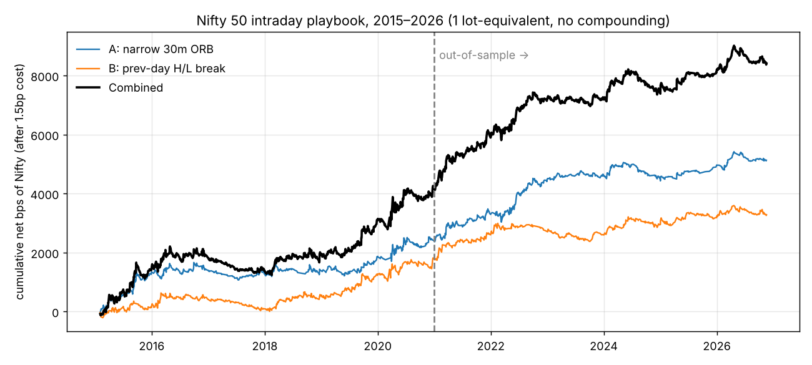

# Nifty 50 Intraday Options Playbook (from 1‑minute data, Jan 2015 – Nov 2026)

**Data:** 1,095,949 one‑minute bars and 2,923 sessions, built from two public datasets that agree to a median difference of 0.05 pts. They are stitched together in `load_data.py`.
**Method:** Rules were developed on 2015–2020 (in‑sample) and checked on 2021–2026 (out‑of‑sample). A cost of 1.5 bps per round trip is deducted. All results are in **index bps**: 1 bp ≈ 2.5 Nifty points at 25,000.

> This is historical research, not financial advice. Past patterns can stop working, and
> the option‑pricing layer (IV, spreads, theta) was **not** backtested because no historical
> options data was available. Paper‑trade it first.

---

## 1. What the data says (and what it does NOT)

| Idea | Result | Verdict |
|---|---|---|
| Tally W → D → 4H → 1H → 15m → 10m → 5m and trade when all agree | 7/7 aligned produces **slightly negative** returns over the next 60 min. Bullish weekly, daily or 4H trend slightly *reduces* forward intraday returns. | ❌ No edge. Don't use alignment as an entry signal. |
| Weekly / daily EMA trend filter on intraday breakouts | Helps 2015–20, adds **nothing** 2021–26 | ❌ Overfit |
| Small gaps fill (87% of gaps under 0.2%, 54–64% of gaps of 0.2–0.5%) | True, but **fading** gaps loses money after costs (PF 0.65–0.98) | ❌ Statistic ≠ tradable edge |
| Last‑hour momentum (day's direction at 14:25 continues to close) | PF 1.31 in 2015–20, **dead** after 2021 | ❌ Decayed |
| Breakouts with fixed small targets (1× opening range) | Win rate 52–54%, but negative expectancy | ❌ |
| **Opening‑range breakout when the first 30 min is NARROW** | PF 1.23 in‑sample / **1.32 out‑of‑sample**. Edge gets stronger the narrower the range. | ✅ **Setup A** |
| **Previous‑day high/low breakout after 10:15** | PF 1.19 in‑sample / **1.19 out‑of‑sample** | ✅ **Setup B** |
| Confirmation candle 5m vs 10m vs 15m | Practically identical results | Use whichever you can watch |

Other facts worth knowing:
- Volatility is highest from 09:15 to 10:00 (2× midday), lowest from 11:30 to 12:30, and picks up again from 14:00 to 15:00.
- Expiry days do **not** have bigger ranges than other days (1.07% vs 1.11%).
- Month seasonality over 12 years: Apr/Jul/Oct/Nov were strong, Jan/Feb weak. Only 12 samples per month, so treat it as weak context, not a signal.

**The core pattern:** Nifty compresses (narrow opening range, or price stays inside yesterday's range) and then expands. When it breaks, the move tends to keep going into the close. **Profit comes from letting the 10–20% of big trend days run.** The win rate is only about 44%: the average win is about 46 bp (≈115 pts) and the average loss about 29 bp (≈73 pts).
"Mostly profitable" therefore means **positive months and years, not a high win rate.**

---

## 2. Setup A: Narrow Opening‑Range Breakout (primary)

**Pre‑market (computed before 09:15)**
- `ATR14` = 14‑day average true range of daily Nifty candles, up to yesterday.

**Rules**
1. Mark the **opening range (OR)**: the high and low of 09:15–09:45.
2. **Trade only if `OR high − OR low ≤ 0.35 × ATR14`.** About 1 day in 3 qualifies.
   Narrower is better: under 0.25 × ATR gave PF 1.34–1.60, under 0.20 × ATR gave PF 1.7–2.0 (rarer).
3. Entry: the **first 5‑min (or 10/15‑min) candle that closes above the OR high → long**, or below the OR low → short. Last entry 12:00. One trade per day.
4. Initial stop: **the opposite side of the OR**, judged on Nifty spot.
5. Trailing stop: once in profit, trail **0.6 × ATR14** behind the best price.
6. Exit at stop or trail, **or at 15:20**. No fixed small target (a target of 1.0 × ATR is acceptable, see below).

**Backtest:** 1,116 trades. In‑sample avg +4.1 bp (PF 1.23). Out‑of‑sample avg +5.1 bp (PF 1.32), win rate about 47%.
Shorts were stronger than longs (+7.5 bp vs +3.0 bp per trade).

## 3. Setup B: Previous‑Day High/Low Breakout (secondary)

1. Condition: today's **open is inside yesterday's high–low range**.
2. From **10:15 to 13:30**, take the first 5‑min close **above yesterday's high (long)** or **below yesterday's low (short)**.
3. Stop: **0.25 × ATR14** from the entry price. Trail 0.6 × ATR. Exit 15:20.

**Backtest:** 1,078 trades. Win rate about 41%, avg +3 bp, PF 1.19 in both halves.
When A and B fire on the same day (380 days), the trades are correlated (0.67), so use **half size each** on those days.

## 4. Combined result (A + B)

- 2,194 trades, PF 1.23, **profitable in 11 of 12 years** (2017 was −434 bp) and **58% of months**
- Total ≈ +8,400 bp (≈ +21,000 Nifty points on a 1× notional, no compounding)
- **Max drawdown ≈ −970 bp (≈ −2,400 pts)**. The longest losing streak was 12 trades.
- 2023–2024 were roughly flat. Expect flat stretches lasting months.

---

## 5. Turning the signal into an options trade

Make every decision on **Nifty spot/futures levels**, then express the trade with options:

| Situation | Structure | Why |
|---|---|---|
| Setup A or B long signal | **Bull call debit spread**: buy ATM CE, sell a CE about 1 × ATR14 higher (roughly 200–250 pts today) | The backtest showed a 1 × ATR cap keeps the edge (PF 1.25/1.34 vs 1.28/1.33 uncapped). The spread cuts theta and IV‑crush risk. |
| Short signal | **Bear put debit spread**: buy ATM PE, sell a PE about 1 × ATR lower | Mirror image |
| Signal on expiry day | Use the **next** weekly expiry, or widen to ATM / ATM±1 ATR | Same‑day gamma makes ATM premiums jump around |
| Stop | Exit the spread when **spot** hits the setup stop or trail, not on premium % | The backtest is defined on spot |
| Exit | Close by 15:20. Never carry overnight. | The edge is intraday |

**Hedging/sizing:** risk per trade = (entry − stop) in spot points × spread delta (≈0.35–0.5) × lot size. Keep this at **≤0.5–1% of capital**. The 12‑trade losing streak and the −2,400‑pt drawdown are the numbers to size against.

**About option selling (iron fly / condor):** on days with a narrow first hour (≤0.45 × ATR), Nifty closed within ±0.5 × ATR of its 10:15 price **about 78–80%** of the time, versus 58% on days with a wide first hour. That favours short premium. But those same narrow days produce the Setup A breakouts, and **no historical option prices were available to check whether premiums pay for the tail.** If you sell premium, make it a defined‑risk iron condor with wings beyond 0.5 × ATR, and close it as soon as a Setup A breakout triggers.

### Daily checklist
1. Before 09:15, note **ATR14**, **yesterday's high and low**, and the threshold **0.35 × ATR**.
2. At 09:45, is the OR width ≤ the threshold? If yes, watch for **Setup A**.
3. At 10:15, did the open sit inside yesterday's range? If yes, watch for **Setup B**.
4. On a 5/10/15‑min close beyond the level, open a debit spread in the breakout direction. Use half size if both setups are active.
5. Manage the trade on spot: initial stop, then a 0.6 × ATR trail, flat by 15:20.
6. Max one trade per setup per day. Skip the day if neither condition is met (about 40% of days).

---

## Files
- `load_data.py`: builds the clean 1‑min series
- `htf_stats.py`: monthly, weekly, daily, gap, time‑of‑day and opening‑range statistics
- `mtf.py`: multi‑timeframe alignment test (W/D/4H/1H/15m/10m/5m) with no look‑ahead
- `setups.py`, `refine.py`: setup search, sensitivity checks and range‑day stats
- `final_system.py`: final A+B backtest, `trades_final.csv`, `equity_curve.png`
